# Xinnor wizard UI/UX

## User flow

Поскольку у нас визард, т.е. колея, нужны ясные, четкие ключи - где мы находимся, и как из этой колеи выбраться (желательно безопасно)?

- Шаги видны на каждом шаге, тут все в порядке.
- Я бы посоветовал кнопки Prev-Next, вместо Back-Continue (более распространено).
- Нужна кнопка Stop, потому что сейчас непонятно, как прервать процесс (закрыть окно?), безопасно ли это? Наличие кнопки говорит, что разработчики подумали об этом (и значит это безопасно).
- После нажатия стоп можно показать экран с сообщением о возможности продолжить позже, как это сделать и тп.

## Layout, colors, visual ques

**Плюсы:**

- Общий внешний вид визарда
- Спокойные цвета, читаемые шрифты
- Лаконичность

**Минусы:**

- Отсутствие сепарации основной и вспомогательной информации
- Небольшие проблемы с primary colors
- Бедность графического языка (совсем нет иконок) - но возможно это и плюс!

## Экраны

Пройдемся по экранам последовательно, если есть замечания, они будут под скриншотом или на нем. Красные стрелки - плохо. Сиреневые - хорошо.

#### Отличный пример заголовка

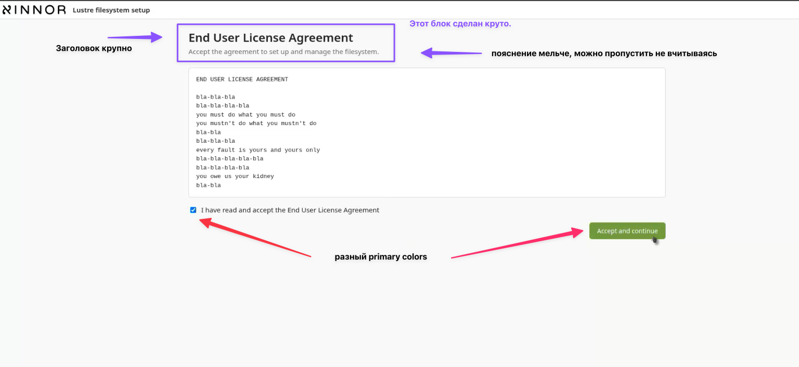

Здесь хорошее соотношение размеров шрифта и их плотности (цвета) для заголовка и деталей.

**Пример из консоли управления DV**

Это то, про что я говорил. Здесь настройки практически полностью слизаны с VS Code. Для разработчков этот паттерн привычен, и они здесь как дома себя чувствуют :). Вам не нужно повторять этот паттерн, просто для примера.

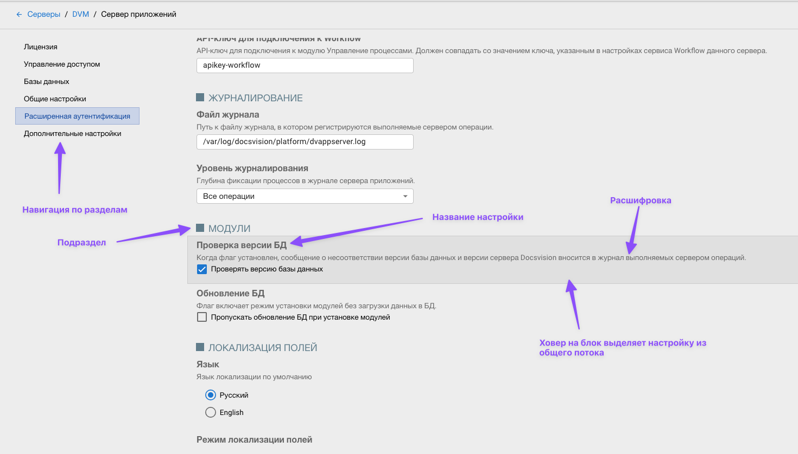

#### Стартовый экран

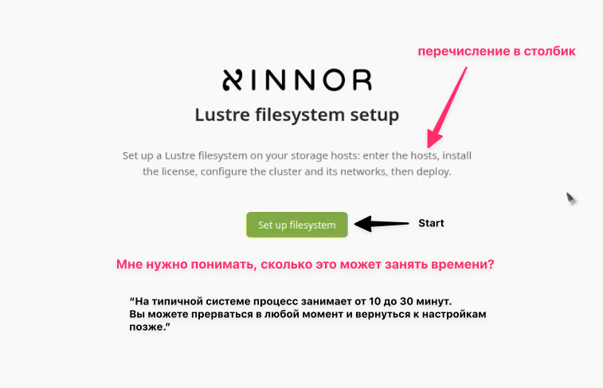

- Я бы сделал перечисление в столбик (легче скользить взглядом и понимаешь примерное количество этапов)
- Уменьшил размер подзаголовка Lustre filesystem setup (постарайтесь, чтобы он был равен по длине логотипу)
- Возможно сделать подзаголовок заглавными буквами, иначе L будет выпирать и цепляться за лого.
- Добавить текст про время и прерывания (но значительно меньшим по размеру - это доп.инфа).
- Кнопку назвать попроще - Start

#### Экран SBB

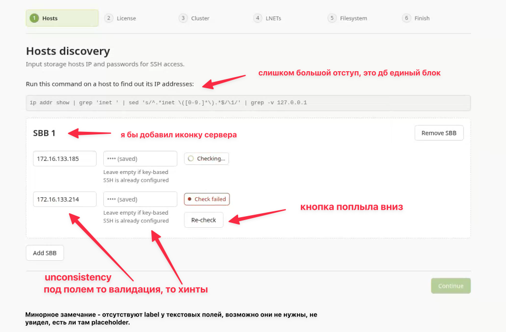

- Нужно постараться вытянуть настройки одного сервера в линию, чтобы не было непонятных скачков.
- Разобраться с хинтами (можно показывать их только при фокусе, например).
- Здесь есть вспомогательный информационный блок (консольная команда). Это напрямую не относится к визарду. Хорошо бы выделять такие блоки из основного потока. Нужно придумать шаблон и придерживаться его.

Вот вариант, как это может выглядеть (возможно нужно немного приглушить голубой цвет):

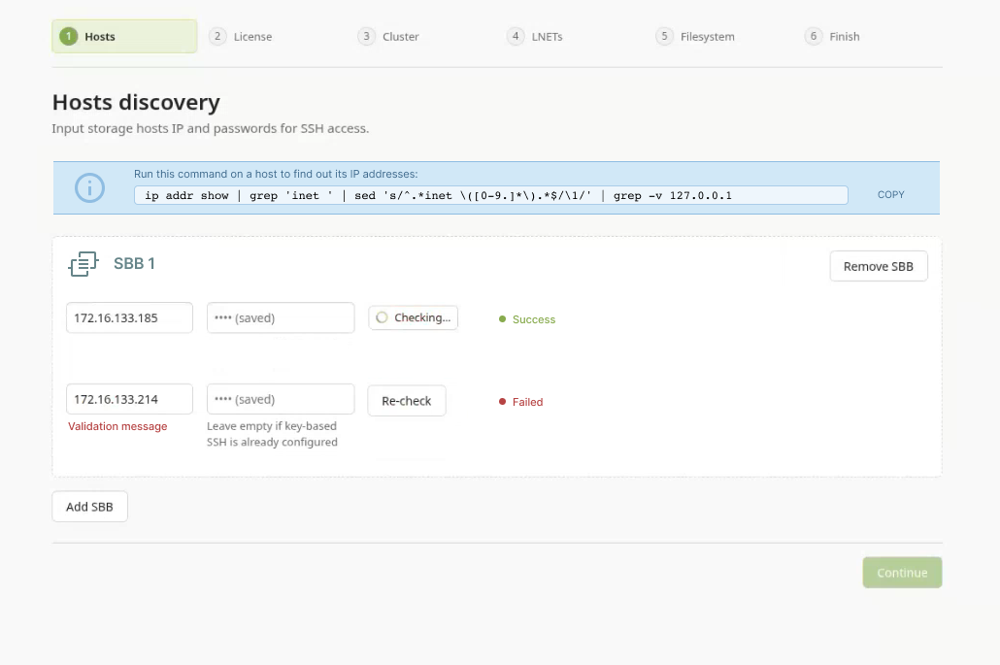

#### Обработка ошибок

При проверке IP показалось странным, что проверка запускается автоматически, без кнопки? Или я что-то пропустил. Непонятно, что значит "saved" в поле пароля. После ошибки кнопка Re-check уползла вниз почему-то.

Я бы сделал обычную кнопку справа от пароля и не двигал ее. Сообщение об ошибке еще правее, там полно места. А по клику на 'Check failed' можно открывать небольшое окошко с информацией и вариантами действия. Выводить все это прямо на страницу не стоит, если там несколько SBB и несколько ошибок, то видя их все сразу - хочется выпить валидол.

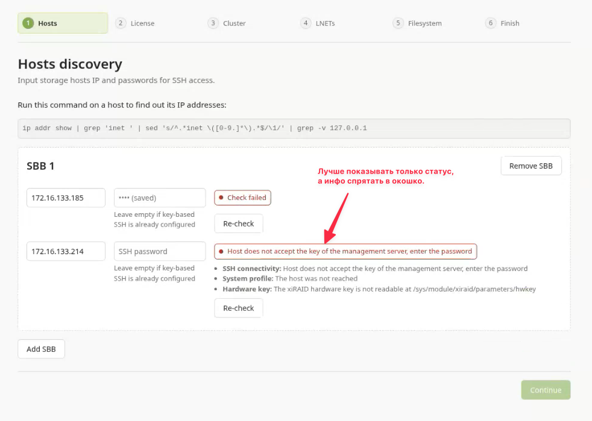

Вариант окна с ошибкой:

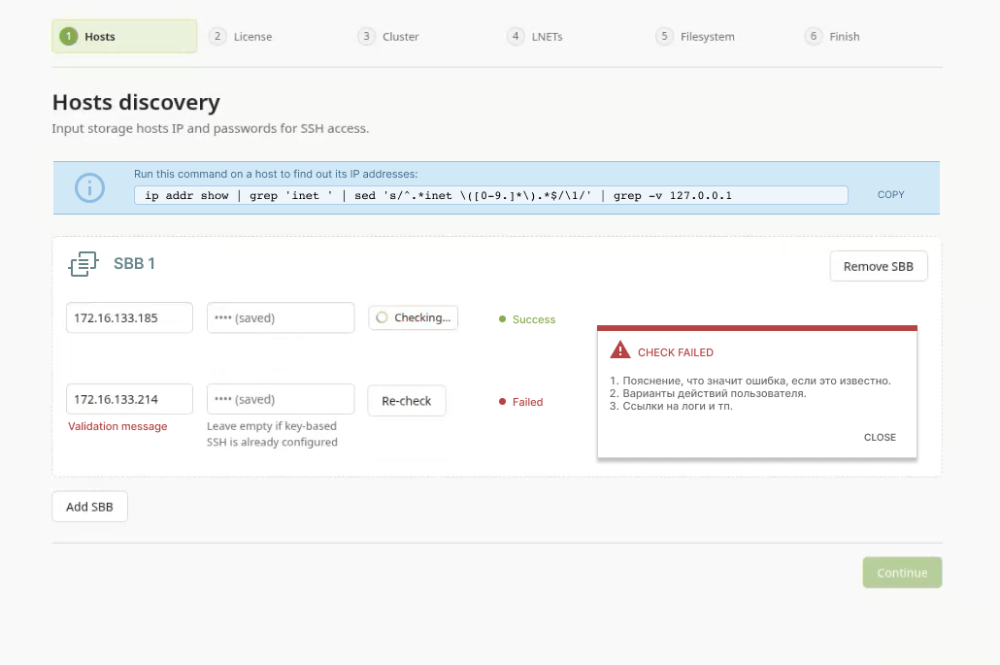

#### License update screen

Очень непонятный экран. Пересмотрел несколько раз, пока понял что тут происходит. Вероятно, дело в том, что поясняющий текст один, а панелей две. Я примерно пронумеровал куда нужно смотреть/кликать - все вперемешку.
Либо надо разбить этот шаг на 2 (запрос лицензии - апдейт лицензии), либо оставить на одном экране, но соответственно разбить поясняющий текст на 2 действия.
Ведь тут и на самом деле 2 действия?

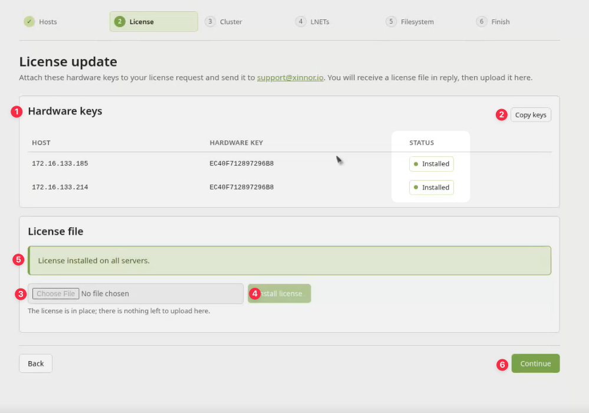

#### Network configuration

Много мелких замечаний, все указаны на скриншоте

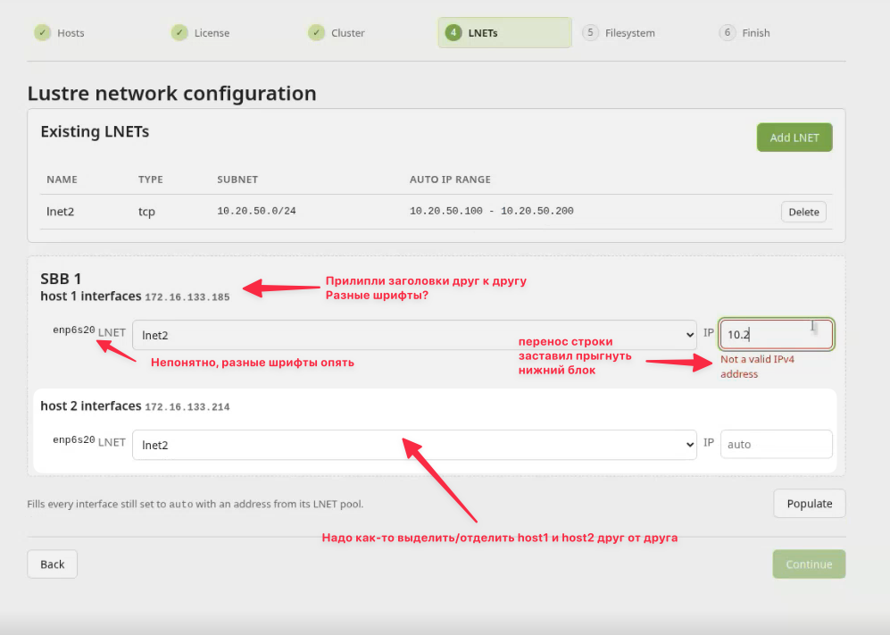

#### FS configuration

Здесь глаз зацепился за крестик. Если эта панель вспомогательная, то лучше ее не убирать совсем по крестику, а сделать распахивающуюся панель (expansion panel)

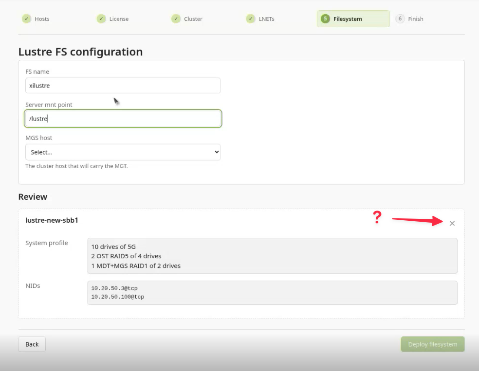

## Прогресс-бары

Здесь повторяются спиннеры. Я бы сделал анимацию первой буквы логотипа (там интересная геометрия: две переплетённые изогнутые линии, скруглённые окончания и почти симметричная композиция.)

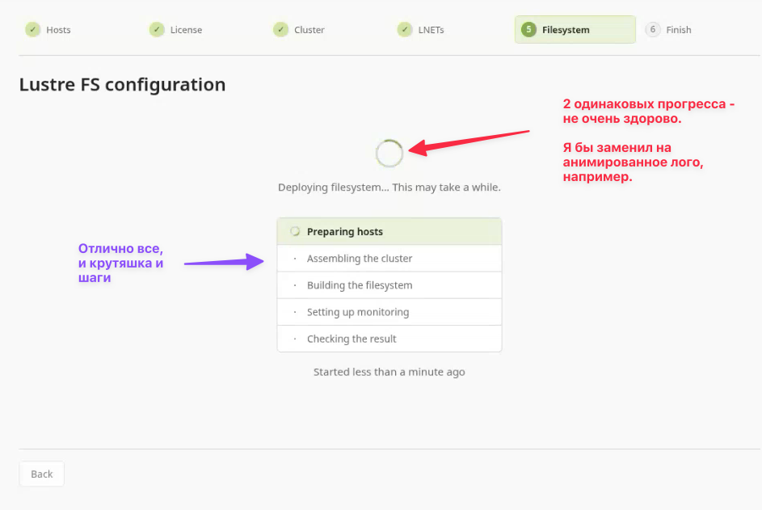

Вот например, chatGPT сгенерил за один промт (геометрия кривая, тк это на коленке без исходников svg) - просто чтобы проиллюстрировать идею.

Получив svg, дальше нужно настроить тайминги в css. В любом случае, мне кажется, спиннеры должны различаться (хотя бы крутиться в разные стороны).

#### Finish screen

Тут мне показалось очень перегружено. Я бы сделал одно сообщение (как у вас вверху зеленая плашка), а все остальное спрятал в доп.панели или кнопки. Отлично, что есть кнопка Open monitoring - понятно, что делать дальше. То есть, нужно донести 2-3 мысли:

- все прошло успешно
- вот тут детали
- вот тут мониторинг и тп.

Иначе непонятно, куда смотреть? Можно оставить всю информацию, если необходимо, но тогда сделать ярче/крупнее success message, а всю информацию сдвинуть вниз, оторвать ее визуально, сделать дополнительной. Потому что сейчас они сливаются.

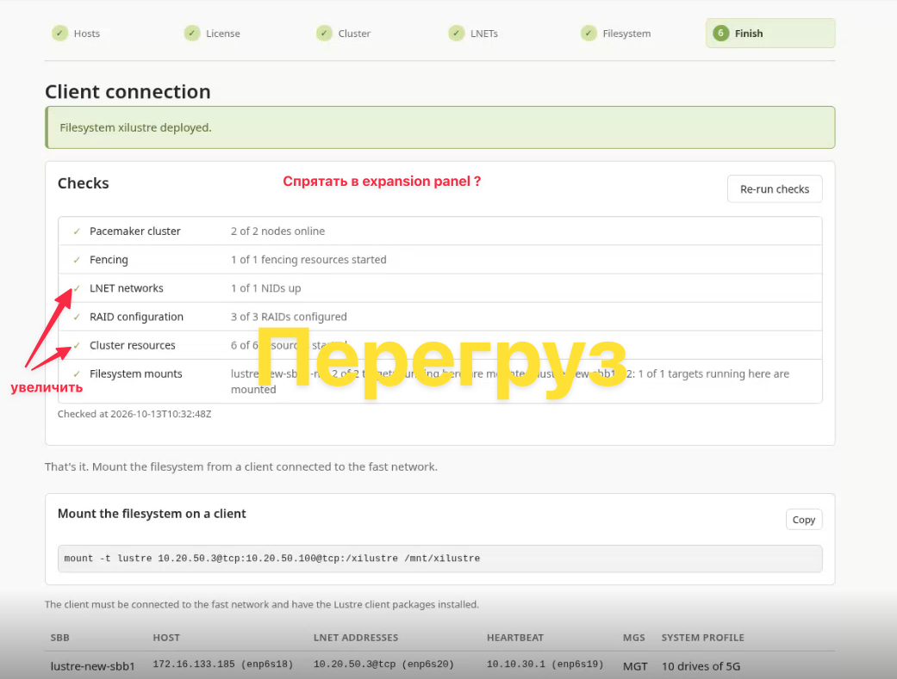

#### Selector component

Последняя мелкая проблема, за которую постоянно цеплялся глаз: в селекторе шеврон слишком близко к краю. Для некоторых людей это очень больно. Если есть возможность, то надо поправить.

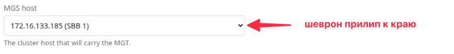

## Общие советы

В общем, надо понимать, что я не ваша целевая аудитория, плюс проектировщик UI, поэтому могу быть пристрастен. Не воспринимайте замечания как догму, вам явно виднее изнутри темы.

Пара советов по верстке. Они не означают, что у вас этим плохо, но они важны.

**Вертикальный ритм**

Вертикальный ритм это паддинги-маргины. В html верстальщик имеет полный контроль только над вертикальными отступами. Поэтому, надо соблюдать простое правило кратности: все отступы не могут быть произвольными, только кратными. Нельзя делать отступ 5px, а следующий 8px! Только .25rem, .5rem, 1rem, 2rem, 4rem и тд. Мозг считывает этот ритм и тогда глаз не будет цепляться за смещенные блоки.

**Клавиатура**

Проверьте навигацию с клавиатуры, работу tab, enter, перемещение фокуса. Фокус у вас показан отлично, он заметен. Но работает ли он на кнопках?

**Иконки**

Графическое оформление очень лаконичное (цветные точки вместо иконок мне понравились!).

Но вдруг они вам понадобятся, ищите здесь: https://icones.js.org/ - очень удобно копировать-скачивать в любом виде.
